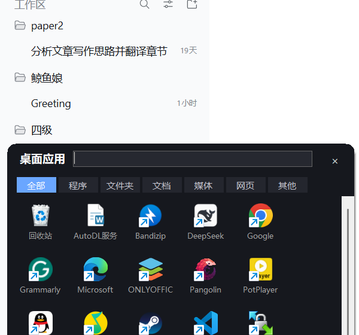

# DesktopBox · 桌面应用盒子

一个不依赖 Seelen UI 的 Windows 桌面应用收纳面板。Dock 上放一个普通快捷方式，点一下在 Dock 上方展开，再点一下收起，行为类似开始菜单。

A standalone Windows desktop app launcher panel. Pin a normal shortcut to your dock; click to toggle a start-menu-like panel above it.



## 功能

- 读取**用户桌面 + 公共桌面**的快捷方式和文件，只读，不移动、不删除
- 自动分类：全部 / 程序 / 文件夹 / 文档 / 媒体 / 网页 / 其他
- 顶部搜索即时过滤
- 单击选中，双击打开，右键：打开 / 打开所在位置 / 从盒子隐藏
- 内置回收站（Shell 命名空间对象），右键可清空
- **自动隐藏桌面新项目**：程序常驻时每 1.5 秒扫描桌面，把新出现的文件/文件夹设为隐藏属性；它们仍会出现在盒子里
- 托盘菜单：显示盒子 / 恢复隐藏项 / 隐藏或显示桌面图标 / 退出
- 单实例 + 注册消息：第二次启动只切换面板，不会开出第二个窗口

## 快速开始

### 方式一：直接用构建好的 exe

1. 解压 release 包；
2. 双击 `桌面应用.lnk`（或 `DesktopBox.exe`）；
3. 把 `桌面应用.lnk` 拖进 Seelen Dock（或任何 dock）即可固定。

### 方式二：自己编译

需要 Windows 自带的 .NET Framework 4.8（`csc.exe`），不需要装 .NET SDK。

```bat
build.cmd
```

如果系统禁用了 PowerShell 脚本，`build.ps1` 需要用：

```powershell
powershell -ExecutionPolicy Bypass -File .\build.ps1
```

产物：`DesktopBox.exe` 和 `桌面应用.lnk`。

## 使用

| 操作 | 行为 |
| --- | --- |
| 点 Dock 图标 / 双击 lnk | 显示面板并置前（不会再把面板关掉） |
| 点面板外 / Esc | 收起（当前版本改为按 Esc 或 × 关闭，避免启动时误隐藏） |
| 单击图标 | 选中 |
| 双击图标 | 用系统默认程序打开 |
| 右键图标 | 打开 / 复制 / 剪切 / 粘贴到桌面 / 删除到回收站 / 移动到… / 重命名 / 清空回收站（回收站）/ 从盒子隐藏 |
| Ctrl+C / Ctrl+X / Ctrl+V | 复制 / 剪切 / 粘贴到桌面（支持从资源管理器复制的文件） |
| Delete / F2 | 删除到回收站 / 重命名 |
| 从资源管理器拖入面板 | 复制到桌面 |
| 从面板拖到资源管理器 | 由资源管理器决定复制或移动 |
| 托盘图标 | 显示盒子、恢复隐藏项、切换桌面图标、退出 |

隐藏项记录在 `%APPDATA%\DesktopBox\hidden.txt`。

## 文件操作

- 右键菜单提供复制、剪切、粘贴到桌面、删除到回收站、移动到文件夹、重命名；
- 快捷键：`Ctrl+C` / `Ctrl+X` / `Ctrl+V` / `Delete` / `F2`；
- 从资源管理器把文件拖进面板会复制到桌面；从面板把图标拖到资源管理器由系统决定复制或移动；
- 删除走回收站，不做永久删除。

## 自动隐藏

程序运行期间（含开机自启）会每 1.5 秒检查：

- 用户桌面：新文件/文件夹自动加 `Hidden` 属性，桌面上不再显示，但会出现在盒子里；
- 公共桌面：尝试同样处理，但需要管理员权限，普通权限下可能失败；
- 例外：`桌面应用盒子.lnk`、`desktop.ini`、`thumbs.db` 不会被隐藏。

停止程序后，新文件不会再被自动隐藏；已有的隐藏属性不会自动恢复。

## 隐藏桌面图标说明

托盘里的“隐藏/显示桌面图标”会写：

```
HKCU\Software\Microsoft\Windows\CurrentVersion\Explorer\Advanced\HideIcons
```

Windows 有时要重启资源管理器才刷新。**最稳的方式是桌面右键 → 查看 → 显示桌面图标**。

注意：重启 `explorer.exe` 会让 Seelen 等外壳程序丢失 AppBar 注册，需要再 `slu restart` 一次。

## 已知限制

- 只有“自动分类 + 手动隐藏”，还没有自定义分组、拖动排序、叠放
- 不支持从资源管理器拖文件进来
- 只有深色主题
- 回收站固定第一项，暂不支持“此电脑/网络”

## Roadmap

- [ ] 拖动排序、拖到图标上叠放
- [ ] 自定义分组（新增/改名/排序）
- [ ] 从资源管理器拖入
- [ ] 亚克力/玻璃外观、浅色主题
- [ ] 开机自启开关
- [ ] 此电脑 / 网络 / 控制面板

## 项目结构

```
DesktopBox/
├── src/
│   ├── DesktopBox.cs      # 全部逻辑（WinForms，C# 5）
│   ├── app.manifest       # DPI 感知
│   └── icon.ico
├── build.ps1              # 用系统 csc 编译
├── screenshots/
├── .github/workflows/build.yml
├── LICENSE
└── README.md
```

## 发布到 GitHub

```bash
git init
git add .
git commit -m "feat: DesktopBox v0.1.0"
git branch -M main
git remote add origin https://github.com/<your-name>/DesktopBox.git
git push -u origin main
```

## License

MIT，见 [LICENSE](LICENSE)。

## English

DesktopBox is a standalone WinForms launcher for Windows. It reads shortcuts from your desktop folders, groups them by type, and shows them in a borderless panel toggled from a dock shortcut. It does not modify Seelen UI or any shell configuration. Build with the included `build.ps1` using the built-in .NET Framework compiler.
